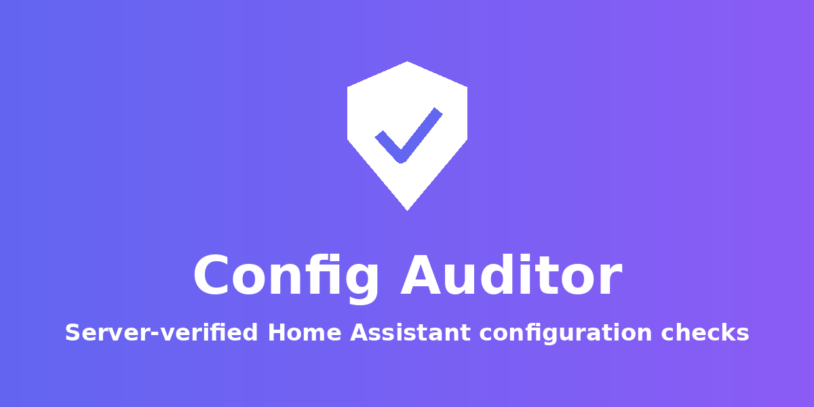
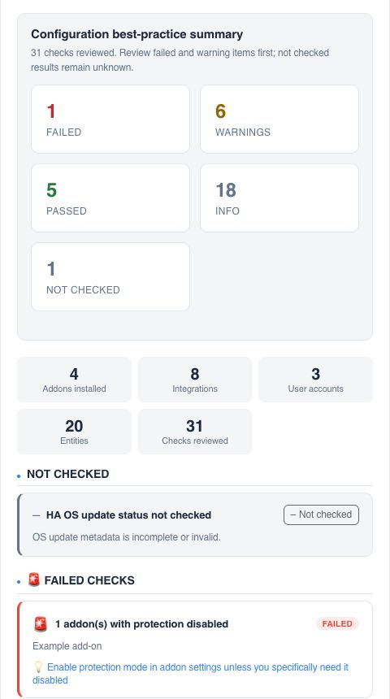
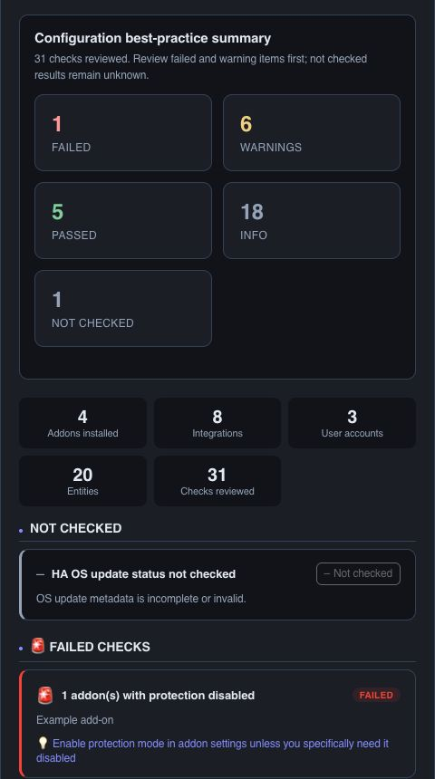

# Config Auditor



Configuration best-practices audit for Home Assistant. Since 6.0.0 the
repository contains a **Home Assistant integration** that verifies login,
administrator and HTTP settings on the server and scans YAML files for
plain-text secrets, plus the Config Auditor card and an admin-only sidebar
panel. It reports Pass / Warning / Failed / Info / Not checked findings with fixes and
changes nothing on its own. It is a review aid, not a security scanner.

[](https://github.com/MacSiem/ha-config-auditor/releases) [](LICENSE)

The card and sidebar panel follow the Home Assistant profile language (English or
Polish, including `pl-PL`). Since 6.0.2, changing that language translates the
visible results immediately, preserving the active tab and cached audit data
without making another audit request. Other profile languages use English.

Version 6.1 adds manual local audit reports and comparison by stable check IDs.
An unavailable or skipped check stays unknown and cannot appear as resolved.

## How it works

**Server-verified checks (integration).** The integration runs these on the
Home Assistant server, where the real settings are available, and returns
them through an admin-only WebSocket command (`ha_config_auditor/audit`):

| Check | What is read |
|---|---|
| Login providers | Enabled auth providers; `legacy_api_password` fails, `trusted_networks` warns (fails with `allow_bypass_login`) |
| Administrator MFA | Active administrators who can log in remotely and have no MFA module enabled |
| HTTPS | Whether HA serves TLS itself; an HTTPS external URL is reported as configured, without claiming the remote endpoint was probed |
| Trusted proxies | `trusted_proxies` of the running HTTP server; `0.0.0.0/0` fails, large public ranges warn |
| IP ban | Whether failed logins lead to an IP ban (`ip_ban_enabled` + `login_attempts_threshold`) |
| Plain-text secrets | A bounded heuristic scan of configuration YAML for `password`/`token`/`api_key`/`secret` literals. Findings show file, line and key, never values; an incomplete scan is not a pass. No match is informational, not proof that every secret is protected. |

A check that cannot run is shown as *not checked* with the reason — never as
passed. Without the integration the card says these checks are unavailable
instead of guessing.

**Browser checks (card).** The card adds what the frontend can read itself:

1. **Supervisor & core status.** On load, the card reads Home Assistant Core,
   Supervisor, OS and host info via the Supervisor API (`/core/info`,
   `/supervisor/info`, `/os/info`, `/host/info`) and flags available updates.
   These checks are skipped gracefully on non-Supervised installs (a "No
   Supervisor API" info finding explains what's unavailable).
2. **Add-on hygiene.** Installed add-ons are listed (`/addons`) and checked
   for disabled protection mode, missing auto-update, host networking,
   privileged access, exposed ports without Ingress, and known "risky"
   services (SSH, Samba, FTP, Telnet).
3. **Network & exposure.** Configured URL schemes and loaded Cloud component
   are reported as configuration evidence. Remote reachability, certificate
   validity/renewal, subscription and active tunnel status are not tested.
   Supervisor interface metadata preserves explicit enabled/connected states;
   unavailable values are N/A, and enabled configuration does not prove an UP link.
4. **Users & auth.** Registered users (`config/auth/list`) are checked for
   multiple owner accounts and local-only restriction. `auth/refresh_tokens`
   provides metadata for the **current account only**: only entries explicitly
   typed `long_lived_access_token` count as long-lived tokens; ordinary sessions
   are excluded. No token values or metadata are stored. Denied, unsupported or
   malformed metadata is explicitly **not checked**; other users' tokens are not
   measured. The integration separately checks configured auth providers.
5. **Integrations, entities & backups.** Integrations (`config_entries/get`)
   are listed by config-flow source and setup status, which do not prove Core/HACS origin. A measured empty inventory differs from an unavailable inventory; entity IDs are scanned for cameras,
   person trackers, shell commands and webhook triggers; backups
   (`/backups`) are checked for missing encryption; a running Mosquitto
   add-on has its anonymous-access setting verified.
6. **Findings, not fixes.** Every check produces a Pass, Warning, Failed or
   Info finding with a description and, where relevant, a one-line
   suggested fix. The audit re-runs on Home Assistant updates after five minutes while the
   card is visible — nothing is changed in your configuration automatically.

### What is automatic vs. manual

| Automatic | Manual (optional) |
|---|---|
| Server-side checks every time the card or panel audits | Adding the integration once (Settings → Devices & services) |
| Admin-only **Config Auditor** sidebar panel | Turning the panel off, or turning on Repairs, in the integration options |
| Card registered for dashboards (no resource to add) | Applying any suggested fix yourself |
| Supervisor/OS/Core, add-on, network, user and entity checks in the card | Setting a custom card title |
| Optional: failed and warning checks as **Settings → Repairs** issues, refreshed every 12 hours | |

### Local reports and comparison

After an audit, choose **Save report** to retain a redacted snapshot in this
browser. Reports belong to the current account and card `storage_key`; retention
is at most 20 reports from the last 30 days. No report is saved automatically.
Choose two saved reports to see new, still present, resolved and unknown checks.
The comparison summarizes resolved, new and not checked counts separately;
missing or unverified evidence never increases the resolved count.
Only confirmed matching HA sources, accounts, methods, versions and scopes can
be compared after a reload. If identity or evidence is unavailable, the result
explains the limitation instead of declaring a fix.

**Export selected report** opens a review dialog with filename, JSON/CSV/TXT
format, Included/Excluded scope and the exact preview before Save. Private
inventory counts are off by default; opting in adds only aggregate counts.
Names, addresses, users, tokens, raw findings and configuration are excluded.
The adapter distinguishes confirmed saves from unconfirmed download initiation.
**Clear saved reports** requires confirmation and affects only this report
namespace, preserving other browser data.

## Screenshots

| Light | Dark |
|---|---|
|  |  |

*Overview summary with synthetic checks: Failed, Warnings, Passed, Info and
the separate Not checked count, plus example findings. No household configuration appears in the image. Dark
mode follows your Home Assistant theme.*

## Installation

### Integration (recommended, 6.0.0+)

1. Install the integration files:
   - **HACS:** once the HACS default catalog lists this repository as an
     **Integration**, install **Config Auditor** from HACS → Integrations.
     Until then HACS installs it as a Dashboard plugin (card only), and HACS
     does not allow adding it again as a custom Integration repository.
   - **Manual:** copy `custom_components/ha_config_auditor` from the
     [latest release](https://github.com/MacSiem/ha-config-auditor/releases)
     into your `config/custom_components/` folder.
2. Restart Home Assistant.
3. **Settings → Devices & services → Add integration → Config Auditor.**
   No questions are asked.
4. Open **Config Auditor** in the sidebar (administrators only), or add the
   card to a dashboard:

```yaml
type: custom:ha-config-auditor
```

The integration registers the card for dashboards itself. If the card is
already loaded from a HACS Dashboard install, it does not add a second copy.

Keep your working Dashboard plugin, its resources, and existing card configuration
while trying the integration. In storage mode the integration reuses the existing
card resource. Check that your dashboards still work and the integration is loaded
before retiring the plugin. The public plugin remains available until the
integration release and migration have been verified. A category change alone
is not a verified migration.

**Options** (Settings → Devices & services → Config Auditor → Configure):
show or hide the sidebar panel, and report failed/warning checks in
Settings → Repairs.

### Dashboard plugin only

Installing only the card (HACS → Dashboard) still works, but server-side
checks are then reported as unavailable.

## Features

- **Overview, Findings, Add-ons & Integrations, Network, Users and Tips**
  tabs.
- Pass / Warning / Failed / Info findings with actionable fix suggestions,
  plus a separate neutral Not checked summary for unavailable evidence.
- Supervisor/OS/Core update checks, add-on hygiene, SSL/exposure checks,
  user review and current-account token counts, backup-encryption and MQTT-auth checks.
- Bundled Bento Design System (light + dark mode, follows your HA theme,
  mobile-friendly).
- Self-contained — no shared HA Tools dependency.
- Last-scan timestamp is cached in browser `localStorage`; audit results
  are recomputed on each scan. Redacted report snapshots are stored only after
  an explicit Save report action, with the retention limits above.
- Stable-check comparison and reviewed redacted JSON/CSV/TXT export; unknown
  evidence is never counted as resolved.
- Responsive inventories retain every original field and action in narrow
  cards; keyboard navigation and configuration input keep their focus.
- Integration: server-verified checks, admin-only sidebar panel, optional
  Repairs issues, automatic card registration.

## FAQ

**Do I have to configure anything?**
No. Add the integration (no questions) and open the sidebar panel, or add the
card. Server-side checks and the panel require an administrator.

**Why are some checks missing / show "No Supervisor API detected"?**
Several checks (OS/Supervisor updates, add-on scanning, network interfaces,
backups) require Home Assistant OS or Supervised. On Core-only or Container
installs, those sections show an info finding instead of failing silently.

**Will this change my configuration?**
No. Config Auditor only reads state via the Home Assistant WebSocket/REST
API — it never calls a service that changes configuration. Every finding
includes a fix you apply yourself.

**Does this send data anywhere?**
No. Server checks run inside your Home Assistant and browser checks run in
your browser against your own instance — no telemetry, no analytics, no
external network calls and no CDN-hosted assets. The YAML scan reports file,
line and key names only, never secret values.

## Changelog

See [CHANGELOG.md](CHANGELOG.md).

## Support

If this tool makes your Home Assistant life easier, consider supporting
development:

- [Buy Me a Coffee](https://buymeacoffee.com/macsiem)
- [PayPal](https://www.paypal.com/donate/?hosted_button_id=Y967H4PLRBN8W)

The optional in-card support link is shown only to administrators. Dismiss it in the card or set `show_support: false` in the card configuration.

## License

MIT, see [LICENSE](LICENSE).

## Privacy and data

The integration reads security settings and allowed configuration files on your Home Assistant server. Audit results can reveal security weaknesses. Treat findings and YAML as private, and share only a minimal redacted reproduction. The audit itself does not modify the configuration.

Manual report snapshots persist locally in this browser for the current account
and card namespace. Their schema excludes raw findings, names, account IDs,
tokens, addresses and configuration. Local namespace references are not export
fields. The integration reads the existing HA instance identity through bounded
read-only access to confirm comparisons; it does not create, repair or migrate
that storage. Missing identity leaves cross-session comparison unavailable.

See [SECURITY.md](SECURITY.md) for safe vulnerability reporting and [NOTICE](NOTICE) for licensing notices.

First-run guidance, Refresh and optional support labels follow the Home Assistant language (Polish or English, including Polish regional locales). Switching language preserves visible findings, keyboard focus, the selected tab, authored title and dismissal choices, and does not trigger another audit. The Findings and Tips names in the guidance match the current tab labels. Use Refresh in the card or sidebar panel to retry unavailable checks without navigating away. Tabs, summaries, findings, tips and unavailable states also follow the profile language. Raw names, versions and network evidence are preserved.

Unloading the integration disables its server audit command and removes its own YAML fallback module. Pending replies are discarded if the integration is unloaded or administrator permissions are lost. Foreign dashboard resources and modules are preserved.
